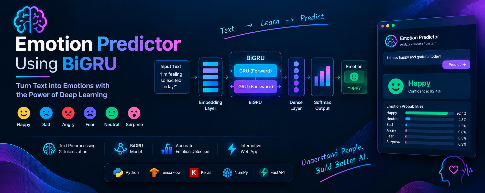
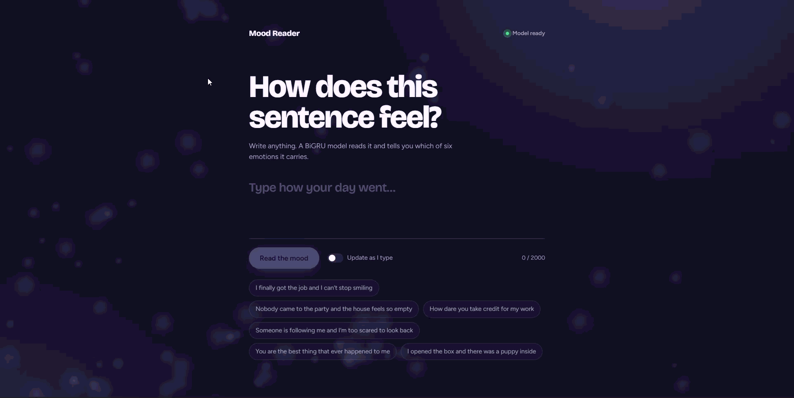
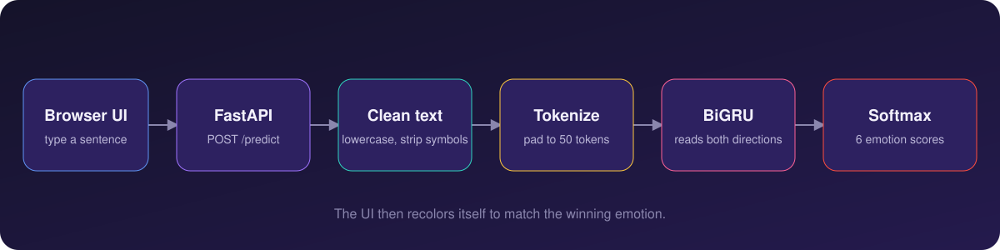

<div align="center">



<br><br>

**A deep learning web app that reads a sentence and tells you which of six emotions it carries.**

<br>

[](https://emotion-prediction-w4xr.onrender.com)


</div>

<br>

> **Try it now:** [emotion-prediction-w4xr.onrender.com](https://emotion-prediction-w4xr.onrender.com)
> The app is on Render's free tier, so the first load after a quiet spell can take up to a minute while the server wakes up. The status dot in the top right turns green when the model is ready.

---

## Preview

<!-- Replace with your own screenshot or GIF: save it as assets/demo.png (or demo.gif) -->
<div align="center">
  
</div>

---

## What it does

Type any sentence and the model scores it against six emotions: **sadness, joy, love, anger, fear and surprise**. The interface responds to the result.

| | |
|---|---|
| **Mood-reactive background** | A field of glowing particles changes colour and movement with the predicted emotion. Joy bounces, sadness sinks, love pulses, anger and fear jitter. |
| **Full probability breakdown** | A confidence ring plus a bar for each of the six emotions, so you can see how close the second guess was. |
| **Live mode** | Turn on "Update as I type" and the prediction refreshes as you write. |
| **Instant examples** | Click a sample sentence to see the model in action without typing. |
| **Recent readings** | Your last few predictions stay on screen, and a click re-runs any of them. |
| **Cold-start aware** | The page polls `/health` and shows whether the model has finished loading. |
| **Accessible** | Keyboard friendly, visible focus states, respects reduced-motion settings, works on mobile. |

---

## The emotions

| Emotion | Emoji | Colour in the UI |
|---|:---:|---|
| Sadness | 😢 |  Blue |
| Joy | 😄 |  Yellow |
| Love | ❤️ |  Pink |
| Anger | 😠 |  Red |
| Fear | 😨 |  Violet |
| Surprise | 😲 |  Teal |

---

## How it works

<div align="center">
  
</div>

1. **Clean the text.** The input is lowercased, apostrophes and special characters are removed, and extra whitespace is collapsed.
2. **Tokenize and pad.** A fitted Keras `Tokenizer` (loaded from `tokenizer.pkl`) turns words into integer IDs. Sequences are padded or truncated to **50 tokens**.
3. **Predict.** A **Bidirectional GRU** reads the sequence forwards and backwards, which helps it use context on both sides of a word, then a softmax layer outputs a probability for each emotion.
4. **Respond.** FastAPI returns the top emotion, its confidence and all six scores as JSON, and the frontend animates the result.

The model and tokenizer load once at startup through FastAPI's lifespan handler, so each request only pays for inference.

---

## Tech stack

| Layer | Tools |
|---|---|
| Model | TensorFlow / Keras, Bidirectional GRU |
| Backend | FastAPI, Pydantic, Uvicorn, Gunicorn |
| Frontend | Vanilla HTML, CSS and JavaScript, Canvas particle system, no frameworks |
| Hosting | Render |

---

## Project structure

> Adjust file names below if yours differ.

```
emotion-prediction/
├── Artifacts/
│   ├── BiGRU_model.keras      # trained model
│   └── tokenizer.pkl          # fitted tokenizer
├── static/
│   └── index.html             # frontend (HTML, CSS and JS in one file)
├── assets/                    # README images
├── main.py                    # FastAPI application
├── requirements.txt
└── README.md
```

---

## API reference

Interactive docs are available at [`/docs`](https://emotion-prediction-w4xr.onrender.com/docs) (Swagger UI).

| Method | Endpoint | Description |
|---|---|---|
| `GET` | `/` | Serves the web interface |
| `GET` | `/health` | Reports whether the model and tokenizer are loaded |
| `POST` | `/predict` | Predicts the emotion for a piece of text |

<details>
<summary><b>Example request and response</b></summary>

<br>

```bash
curl -X POST https://emotion-prediction-w4xr.onrender.com/predict \
  -H "Content-Type: application/json" \
  -d '{"text": "I am feeling very happy today!"}'
```

```json
{
  "text": "I am feeling very happy today!",
  "predicted_emotion": "joy",
  "confidence": 0.97,
  "all_emotions": {
    "sadness": 0.004,
    "joy": 0.970,
    "love": 0.016,
    "anger": 0.003,
    "fear": 0.003,
    "surprise": 0.004
  }
}
```

Values above are illustrative. Input must be between 1 and 2000 characters. If the model is still loading, the API returns `503`.

</details>

---

## Run it locally

**Requirements:** Python 3.11 (TensorFlow does not yet support the newest Python releases).

```bash
# 1. Clone
git clone https://github.com/devbytush/emotion-prediction.git
cd emotion-prediction

# 2. Create a virtual environment
python -m venv .venv
source .venv/bin/activate        # Windows: .venv\Scripts\activate

# 3. Install dependencies
pip install -r requirements.txt

# 4. Start the server
uvicorn main:app --reload
```

Open [http://localhost:8000](http://localhost:8000).

---

## Deploy on Render

1. Create a new **Web Service** and connect this repository.
2. Set the build and start commands:

   | Setting | Value |
   |---|---|
   | Build command | `pip install -r requirements.txt` |
   | Start command | `gunicorn main:app -k uvicorn.workers.UvicornWorker --workers 1 --bind 0.0.0.0:$PORT` |

3. Add an environment variable `PYTHON_VERSION` set to `3.11.9`. Render does not read `runtime.txt`.
4. Deploy.

**Tips**
- Keep `--workers 1` so the model loads once and memory stays low.
- Use `tensorflow-cpu` instead of `tensorflow` to keep the build smaller.
- TensorFlow is memory hungry. If the service restarts on startup, the free 512 MB tier may be too small.

---

## Model details

| | |
|---|---|
| Architecture | Embedding, Bidirectional GRU, Dense (softmax) |
| Classes | 6 (sadness, joy, love, anger, fear, surprise) |
| Max sequence length | 50 tokens |
| Test accuracy | XX% |
| Macro F1 | XX% |

<!-- Fill in the XX values from your notebook. If you have a confusion matrix image, add it here:
 -->

**Known limitations**
- The model only knows these six emotions. Neutral text will still get pushed toward one of them.
- It was trained on short English text, so long passages, slang, sarcasm and other languages may produce unreliable results.
- Text is cut off after 50 tokens.

---

## Roadmap

- [ ] Neutral / no-emotion class
- [ ] Batch prediction endpoint
- [ ] Compare against a transformer baseline such as DistilBERT
- [ ] Shareable result cards
- [ ] Docker image

---

## Contributing

Issues and pull requests are welcome. For larger changes, please open an issue first so we can talk it through.

---

## Author

**Tushar** ([@devbytush](https://github.com/devbytush))

If this project helped you, consider leaving a ⭐ on the repo.
